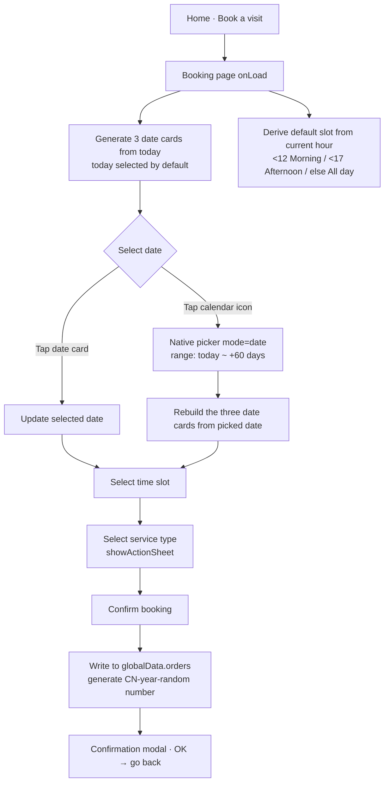
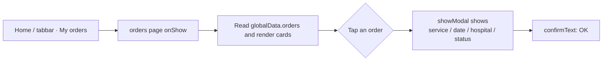

# SilverCare — Technical Architecture & Business Flow

[中文](./ARCHITECTURE.md) | English

A WeChat mini program for **hospital companion services for the elderly** (UI language: English). Its current form is an interactive frontend prototype with **no backend and no login**: all data lives in memory, the interaction loop is complete, and it can run directly in WeChat DevTools for demos.

---

## 1. Tech Stack

| Layer | Choice | Notes |
| --- | --- | --- |
| Runtime | Native WeChat mini program framework | No cross-platform frameworks such as Taro / uni-app |
| View | WXML + WXSS | WXSS uses CSS variables as design tokens |
| Logic | Native JS (ES6) | Pages defined via `Page({})`, no TypeScript |
| UI library | `@vant/weapp` 1.10.x | Only a few components used, e.g. `van-icon`, `van-button` |
| Dependency build | npm + DevTools "Build npm" | `packNpmManually: true`, output to `miniprogram_npm/` |
| Data layer | `App.globalData` in-memory singleton | No state-management library, no network requests, no persistence |

Key configuration: `project.config.json` (`miniprogramRoot: "./"`, `packNpmRelationList` pointing to the root directory), `app.json` (page registration and global window styles).

---

## 2. Directory Structure

```
SilverCare/
├── app.js                  # App instance: global data (userName, orders)
├── app.json                # Page registration, global window styles
├── app.wxss                # Global design tokens and shared classes (.card/.brand-btn/.row...)
├── assets/
│   └── hero-home.jpg       # Home banner image (1080×432, replaceable with real assets)
├── pages/
│   ├── index/              # Home (four entries + custom tabbar)
│   ├── book/               # Booking / order creation
│   ├── orders/             # Order list + detail modal
│   ├── report/             # Service report
│   ├── urgent/             # Urgent help (simulated customer-service chat)
│   └── customer/           # Profile
├── miniprogram_npm/        # Dependencies built from Vant Weapp
├── reference/              # Design mockup references (not compiled)
├── project.config.json
├── package.json
└── sitemap.json
```

Each page directory contains the usual four files `*.js` / `*.wxml` / `*.wxss` / `*.json`; the `*.json` file registers components such as `van-icon` as needed.

---

## 3. Runtime Architecture

### 3.1 Data Layer: the App Singleton

`app.js` is the single source of truth for the whole app; pages read and write via `getApp()`:

```js
App({
  globalData: {
    userName: 'Mrs. Wang',
    orders: [
      { id: 'CN-2026-0418', date: '2 Jun', hospital: 'PUCH', service: 'Outpatient companion', status: 'Scheduled' },
      { id: 'CN-2026-0402', date: '29 Apr', hospital: 'PUCH', service: 'Outpatient companion', status: 'Completed' }
    ]
  }
})
```

- Writer: `pages/book` prepends a new order with `unshift` on confirmation
- Reader: `pages/orders` syncs it into page `data` in `onShow`
- Characteristic: **in-memory only** — a cold start resets to the seed data

### 3.2 Routing & Navigation

All navigation uses `wx.navigateTo` (keeps the page stack, supports going back). Pages **pass no parameters** to each other; business data flows through the shared `globalData`.

### 3.3 Navigation Bar & Tabbar

- The top bar uses the native navigation bar; each page sets its own title and colors in its `*.json` (white on Home, blue `#2f6fe4` on Report)
- The bottom tabbar is **not** the native `tabBar` — it is an inline `.tabbar` + `.tab` structure on each page (Home: Home/Orders/Profile; Profile: Home/Orders/Report), with navigation via `wx.navigateTo`
- Therefore Home and Profile are two separate pages, not two tabs of one page

### 3.4 Styling System

`app.wxss` defines design tokens and shared classes; page styles only handle layout differences:

| Token / class | Purpose |
| --- | --- |
| `--brand-blue/green/orange/red` | Colors of the four primary action buttons, matching the four Home entries |
| `--ink` / `--muted` / `--line` / `--bg` | Text, dividers, page background |
| `.page` / `.card` | Page container, white rounded card |
| `.brand-btn` + `.blue/.green/.orange/.red/.ghost` | 96rpx-tall primary button; `::after` removes the native border |
| `.row` / `.between` / `.muted` / `.strong` | Shared layout and text utilities |

Units are consistently `rpx`; bottom-fixed elements use `env(safe-area-inset-bottom)` to adapt to notched screens.

---

## 4. Page Inventory

| Page | Path | Responsibility | Main interactions |
| --- | --- | --- | --- |
| Home | `pages/index/index` | Brand greeting, service entries | Four buttons navigate to Booking / Orders / Report / Help; tabbar → Profile |
| Booking | `pages/book/book` | Pick date, time slot, service type | Date cards + calendar picker, time-slot cards, `showActionSheet` for service, confirm order and go back |
| Orders | `pages/orders/orders` | Order list | Tap an order to show a summary via `showModal` |
| Service Report | `pages/report/report` | Receipt for one visit | Review (toast placeholder), Share with family (copy link to clipboard) |
| Urgent Help | `pages/urgent/urgent` | Customer-service chat | Send a message; a fixed reply is appended after 800ms |
| Profile | `pages/customer/customer` | Account and frequent entries | Same four-row layout as Home + tabbar |

---

## 5. Business Flow

### 5.1 Booking (core flow)



Implementation notes (`pages/book/book.js`):

- `buildDates(count, base)`: generates consecutive dates from `base`; cards show `Tue / 17 Nov`, with `key` as `YYYY-MM-DD`
- `formatDate(d)`: unified `YYYY-MM-DD` format for the picker's `start` / `end` / `value`
- `currentSlot()`: derives the default slot from the current hour instead of hardcoding
- A date picked in the calendar is written back as the date-card base, keeping it visible and re-selectable

### 5.2 Order Viewing



Only two statuses exist: `Scheduled` (blue) and `Completed` (green), mapped to style classes by a ternary expression in WXML.

### 5.3 Service Report

A single display-only page: key-point reminder → large placeholder receipt image → three completed items → next visit → consent and record retention → `Review` / `Share with family`. Sharing uses `wx.setClipboardData` to copy fixed text, simulating "send to family".

### 5.4 Urgent Help

A pure-frontend chat: two local arrays `mines` (our messages) and `replies` (agent replies). `onSend` enqueues our message first, then `setTimeout 800ms` appends a fixed reply, creating the feel of a live agent.

### 5.5 Entry & Identity

**The login / phone-authorization flow has been removed**: no `wx.login`, no `getPhoneNumber`, no session cache — users land on Home directly and every entry is tappable. The greeting on Home and Profile is static text (`Hello, Mrs Wang ✨`), with no logged-out branch.

---

## 6. Data Model

```js
Order {
  id: string        // 'CN-2026-4187', year = current year, last 4 digits random
  date: string      // '17 Nov', from the selected date-card label
  hospital: string  // currently fixed 'PUCH'
  service: string   // service name, e.g. 'Outpatient companion'
  status: string    // 'Scheduled' | 'Completed'
}
```

The service catalog (static config in the `book` page): companion / care / report pickup only, each with price and duration. Time slots (Morning / Afternoon / All day) are business constants, not date data.

---

## 7. Implementation Conventions & Notes

1. **No hardcoded dates/times**: date cards, picker ranges, and the default slot are all derived from `new Date()`; reuse `buildDates` / `formatDate` for new requirements.
2. **Native modal button labels must be explicit**: when `wx.showModal` omits `confirmText` / `cancelText`, WeChat uses built-in Chinese labels ("确定" / "取消") regardless of page language. All three current calls pass English explicitly.
3. **Image assets**: `assets/hero-home.jpg` is cropped to a banner ratio and compressed (~138KB); when replacing it, keep roughly 2.5:1 landscape and a few hundred KB to avoid bloating the main package.
4. **Package size**: the main package limit is 2MB; `miniprogram_npm/` is generated by Vant. Register only the components you actually use.
5. **Style changes**: prefer editing tokens in `app.wxss` over scattering color values in pages.

---

## 8. Known Limitations

- No data persistence: `globalData` only lives for the current run; a restart resets orders to the seed data
- No backend API, no payments, no real customer-service channel or push notifications
- The custom tabbar is inline per page, with active state hardcoded per page and no transition animation
- Order details use a system modal that cannot be restyled; a custom dialog component is needed to match the design
- The booking page uses `wx.showActionSheet` for service selection; its cancel label is built into WeChat and cannot be switched to English
- Service-report content is static placeholder (receipt image, next-visit date are examples)

---

## 9. Evolution Suggestions

1. Integrate cloud development or a self-hosted API, persist `Order` server-side, and demote `globalData` to a cache
2. Extract the tabbar into a `custom-tab-bar` component or switch to the native `tabBar` so the framework manages active state
3. Extract `utils/date.js` (date generation, formatting, slot logic) and `utils/format.js` for reuse across the booking and orders pages
4. Centralize copy in `constants/copy.js` to prepare for future i18n or copy changes
5. Replace `wx.showModal` with a custom `dialog` component for consistent visuals and English buttons
