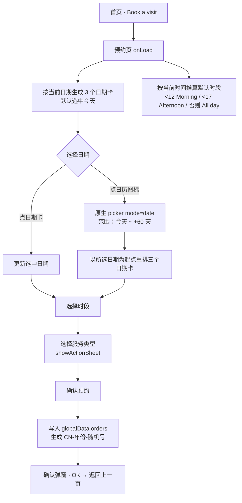
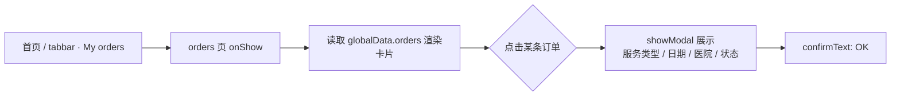

# SilverCare 技术架构与业务流程

中文 | [English](./ARCHITECTURE.en.md)

面向老年人的**医院陪诊服务**微信小程序（界面语言为英文），当前形态为「无后端、无登录」的前端可交互原型：所有数据存在内存中，交互闭环完整，可直接在小程序开发者工具中运行演示。

---

## 1. 技术栈

| 层次 | 选型 | 说明 |
| --- | --- | --- |
| 运行环境 | 微信小程序原生框架 | 未使用 Taro / uni-app 等跨端框架 |
| 视图 | WXML + WXSS | WXSS 使用 CSS 变量作为主题令牌 |
| 逻辑 | 原生 JS（ES6） | 页面通过 `Page({})` 定义，无 TypeScript |
| UI 组件库 | `@vant/weapp` 1.10.x | 仅引入 `van-icon`、`van-button` 等少量组件 |
| 依赖构建 | npm + 开发者工具「构建 npm」 | `packNpmManually: true`，产物输出到 `miniprogram_npm/` |
| 数据层 | `App.globalData` 内存单例 | 无状态管理库、无网络请求、无持久化 |

关键配置：`project.config.json`（`miniprogramRoot: "./"`、`packNpmRelationList` 指向根目录）、`app.json`（页面注册与全局窗口样式）。

---

## 2. 目录结构

```
SilverCare/
├── app.js                  # App 实例：全局数据（userName、orders）
├── app.json                # 页面注册、全局窗口样式
├── app.wxss                # 全局主题令牌与通用类（.card/.brand-btn/.row...）
├── assets/
│   └── hero-home.jpg       # 首页横幅图（1080×432，可替换为真实素材）
├── pages/
│   ├── index/              # 首页（四大入口 + 自定义 tabbar）
│   ├── book/               # 预约下单
│   ├── orders/             # 订单列表 + 详情弹窗
│   ├── report/             # 服务报告
│   ├── urgent/             # 紧急求助（模拟客服对话）
│   └── customer/           # 个人中心
├── miniprogram_npm/        # 由 Vant Weapp 构建生成的依赖产物
├── reference/              # 设计稿参考图（不参与编译）
├── project.config.json
├── package.json
└── sitemap.json
```

每个页面目录固定包含 `*.js` / `*.wxml` / `*.wxss` / `*.json` 四件套，`*.json` 中按需注册 `van-icon` 等组件。

---

## 3. 运行时架构

### 3.1 数据层：App 单例

`app.js` 是整个应用唯一的数据源，页面通过 `getApp()` 读写：

```js
App({
  globalData: {
    userName: 'Mrs. Wang',
    orders: [
      { id: 'CN-2026-0418', date: '2 Jun', hospital: 'PUCH', service: 'Outpatient companion', status: 'Scheduled' },
      { id: 'CN-2026-0402', date: '29 Apr', hospital: 'PUCH', service: 'Outpatient companion', status: 'Completed' }
    ]
  }
})
```

- 写入方：`pages/book` 在确认预约时 `unshift` 新订单
- 读取方：`pages/orders` 在 `onShow` 中同步到页面 `data`
- 特点：**内存态**，小程序冷启动后回到初始种子数据

### 3.2 路由与导航

全部使用 `wx.navigateTo`（保留页面栈，可返回），页面之间**不传参**，靠共享 `globalData` 传递业务数据。

### 3.3 导航栏与 tabbar

- 顶部导航使用系统原生导航栏，各页面在自身 `*.json` 中设置标题与配色（首页白色，报告页蓝色 `#2f6fe4`）
- 底部 tabbar **不是**原生 `tabBar`，而是每个页面内联的 `.tabbar` + `.tab` 结构（首页 Home/Orders/Profile，个人中心 Home/Orders/Report），点击通过 `wx.navigateTo` 跳转
- 因此首页与个人中心是两个独立页面，而不是同一页面的不同 tab

### 3.4 样式体系

`app.wxss` 定义设计令牌与通用类，页面只写布局差异：

| 令牌 / 类 | 用途 |
| --- | --- |
| `--brand-blue/green/orange/red` | 四个主行动按钮配色，与首页四行入口一一对应 |
| `--ink` / `--muted` / `--line` / `--bg` | 文字、分隔线、页面底色 |
| `.page` / `.card` | 页面容器、白色圆角卡片 |
| `.brand-btn` + `.blue/.green/.orange/.red/.ghost` | 96rpx 高的主按钮，`::after` 清除原生边框 |
| `.row` / `.between` / `.muted` / `.strong` | 通用布局与文字工具类 |

单位统一使用 `rpx`，底部固定元素用 `env(safe-area-inset-bottom)` 适配异形屏。

---

## 4. 页面清单

| 页面 | 路径 | 职责 | 主要交互 |
| --- | --- | --- | --- |
| 首页 | `pages/index/index` | 品牌问候、服务入口聚合 | 四个主按钮导航到 预约 / 订单 / 报告 / 求助；tabbar → 个人中心 |
| 预约 | `pages/book/book` | 选择日期、时段、服务类型 | 日期卡 + 日历选择器、时段卡、`showActionSheet` 选服务、确认下单并返回 |
| 订单 | `pages/orders/orders` | 订单列表 | 点击订单用 `showModal` 展示摘要 |
| 服务报告 | `pages/report/report` | 一次就诊的服务凭证 | Review（toast 占位）、Share with family（复制链接到剪贴板） |
| 紧急求助 | `pages/urgent/urgent` | 客服会话 | 发送消息后 800ms 模拟客服回复 |
| 个人中心 | `pages/customer/customer` | 账户与常用入口 | 与首页同构的四行入口 + tabbar |

---

## 5. 业务流程

### 5.1 预约下单（核心流程）



实现要点（`pages/book/book.js`）：

- `buildDates(count, base)`：以传入日期为起点生成连续日期，卡片展示 `Tue / 17 Nov`，`key` 为 `YYYY-MM-DD`
- `formatDate(d)`：统一 `YYYY-MM-DD` 格式，供 `picker` 的 `start` / `end` / `value` 使用
- `currentSlot()`：用当前小时推导默认时段，避免写死
- 日历选择器选中的日期会回写为日期卡起点，保证所选日期在卡片行中可见、可反选

### 5.2 订单查看



状态仅两种：`Scheduled`（蓝）、`Completed`（绿），由 WXML 三元表达式映射样式类。

### 5.3 服务报告

单页展示型页面：关键点提示 → 大字号单据占位图 → 三条完成项 → 下次到访 → 知情同意与记录留存 → `Review` / `Share with family` 操作。分享通过 `wx.setClipboardData` 复制固定文案，模拟「发给家属」。

### 5.4 紧急求助

纯前端会话：本地维护 `mines`（我方消息）与 `replies`（客服回复）两个数组，`onSend` 先入队我方消息，`setTimeout 800ms` 后追加一条固定回复文案，营造实时客服体验。

### 5.5 进入与身份

**当前已移除登录/手机号授权流程**：无 `wx.login`、无 `getPhoneNumber`、无会话缓存，用户打开即进入首页，所有入口直接可点。首页与个人中心的问候语为静态文案（`Hello, Mrs Wang ✨`），不做未登录态分支。

---

## 6. 数据模型

```js
Order {
  id: string        // 'CN-2026-4187'，年份取当前年，后四位随机
  date: string      // '17 Nov'，来自预约页选中的日期卡文案
  hospital: string  // 目前固定 'PUCH'
  service: string   // 服务类型名称，如 'Outpatient companion'
  status: string    // 'Scheduled' | 'Completed'
}
```

服务目录（`book` 页静态配置）：陪诊 / 陪护 / 仅代取报告，各含价格与时长；时段（Morning / Afternoon / All day）为业务常量，非日期数据。

---

## 7. 实现约定与注意事项

1. **日期时间不硬编码**：日期卡、选择器范围、默认时段均由 `new Date()` 推导；新增需求时优先复用 `buildDates` / `formatDate`。
2. **原生弹窗按钮文案必须显式指定**：`wx.showModal` 未传 `confirmText` / `cancelText` 时使用微信内置中文文案（「确定」「取消」），与页面语言无关。现有三处调用均已显式传英文。
3. **图片资源**：`assets/hero-home.jpg` 已裁为横幅比例并压缩（约 138KB）；替换真实素材时建议保持 ~2.5:1 横版并控制在数百 KB，避免主包膨胀。
4. **包体积**：主包上限 2MB，`miniprogram_npm/` 由 Vant 构建产生，新增组件时注意只注册用到的部分。
5. **样式改动**：颜色、圆角、按钮高度优先改 `app.wxss` 令牌，避免在页面内写散落色值。

---

## 8. 已知限制

- 数据不持久化：`globalData` 仅在本次运行内有效，重启小程序后订单回到种子数据
- 无后端接口、无支付、无真实客服通道与消息推送
- 自定义 tabbar 为页面内联实现，高亮状态按页面写死，切换页面时无过渡动画
- 订单详情为系统弹窗，样式不可定制；如需与设计稿统一需自研弹窗组件
- 预约页服务选择用 `wx.showActionSheet`，其取消按钮文案由微信内置，无法改成英文
- 服务报告内容为静态占位（单据图片、下次到访日期均为示例）

---

## 9. 演进建议

1. 接入云开发或自建 API，把 `Order` 落到服务端，`globalData` 退化为缓存层
2. 将 tabbar 抽为 `custom-tab-bar` 组件或改用原生 `tabBar`，由框架管理选中态
3. 抽出 `utils/date.js`（日期生成、格式化、时段判断）与 `utils/format.js`，供预约页与订单页共用
4. 文案集中到 `constants/copy.js`，为后续多语言或文案调整做准备
5. 用自定义 `dialog` 组件替换 `wx.showModal`，统一弹窗视觉与英文按钮
